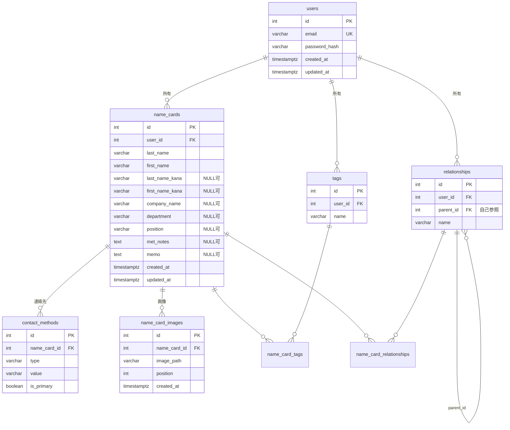

# データベーススキーマ定義

> 正本: `backend/app/models/__init__.py`、`backend/alembic/versions/`、および本番 DB のカタログ実測（2026-11-27）
> PostgreSQL 16.13 / pg_bigm 1.2 / マイグレーション head `1cfddae12df2`

## 概要

| 項目 | 値 |
| --- | --- |
| DB | PostgreSQL 16（`pg_bigm` 拡張で日本語部分一致検索） |
| テーブル数 | 8（＋ Alembic 管理用 `alembic_version`） |
| ユーザー分離 | `users` を頂点に、`name_cards` / `relationships` / `tags` が `user_id` で従属 |
| 削除の連鎖 | DB の `ON DELETE CASCADE` は `name_card_images` のみ。他は ORM（SQLAlchemy）の cascade に依存 |
| スキーマ変更 | Alembic。TS 実装へ移行する際もこの DDL を正とする |

## 概念定義

| 概念 | 意味 | 例 |
| --- | --- | --- |
| **Relationship** | 組織の階層構造（自己参照ツリー、ユーザーごと） | `建築士会/桑名支部/青年会長` |
| **Tag** | フラットな分類ラベル | `ゴルフ仲間`、`友人`、`取引先`、`重要` |
| **ContactMethod** | 連絡先（1名刺に複数、種別＋値＋主系フラグ） | `email`、`tel`、`mobile`、`website` |
| **met_notes** | どこで出会ったか（フリー入力） | `2025年展示会`, `友人の紹介` |
| **memo** | 自由メモ（旧 `notes`。`a70d42ed3c54` でリネーム） | — |

### Relationship と Tag の違い

- **Relationship**: 入れ子（ツリー）で所属を表現。兼務は1人が複数に紐付く（M:N）。`get_full_path()` が祖先をたどって `建築士会/桑名支部/青年会長` を組み立てる。
- **Tag**: 構造を持たない横断分類。名刺とは M:N。

### company_name / department / position の扱い

`a70d42ed3c54` で `name_cards` に追加され、**現在も存在する**（`String(200)`、NULL 可）。旧版の本ドキュメントには「Relationship が包含するため不要」とあったが、実装は両方を保持している。OCR 結果の一時保存先として使い、Relationship とは独立に編集できる。TS 移行時もこの二重管理をそのまま引き継ぐか、どちらかへ寄せるかを決める必要がある（`docs/plans/nextjs-fullstack-rebuild.md` の未決事項）。

## ER 図

## テーブル定義

### users

| カラム | 型 | NULL | 既定値 | 備考 |
| --- | --- | --- | --- | --- |
| `id` | serial | NO | 連番 | PK |
| `email` | varchar(255) | NO | — | UNIQUE（`users_email_key`） |
| `password_hash` | varchar(255) | NO | — | ハッシュ化済みパスワード |
| `created_at` | timestamptz | NO | `now()` | |
| `updated_at` | timestamptz | NO | `now()` | 更新はアプリ側（`onupdate`）で行う |

### name_cards

| カラム | 型 | NULL | 既定値 | 備考 |
| --- | --- | --- | --- | --- |
| `id` | serial | NO | 連番 | PK |
| `user_id` | integer | NO | — | FK → `users.id`（ON DELETE 指定なし） |
| `last_name` | varchar(100) | NO | — | |
| `first_name` | varchar(100) | NO | — | |
| `last_name_kana` | varchar(100) | YES | — | 検索時にひらがな/カタカナ両対応 |
| `first_name_kana` | varchar(100) | YES | — | 同上 |
| `company_name` | varchar(200) | YES | — | |
| `department` | varchar(200) | YES | — | |
| `position` | varchar(200) | YES | — | |
| `met_notes` | text | YES | — | どこで出会ったか |
| `memo` | text | YES | — | 旧 `notes` |
| `created_at` | timestamptz | NO | `now()` | |
| `updated_at` | timestamptz | NO | `now()` | 更新はアプリ側 |

### contact_methods

| カラム | 型 | NULL | 既定値 | 備考 |
| --- | --- | --- | --- | --- |
| `id` | serial | NO | 連番 | PK |
| `name_card_id` | integer | NO | — | FK → `name_cards.id` |
| `type` | varchar(20) | NO | — | アプリ側で列挙を制限（`email`/`tel`/`mobile`/`fax`/`website`/`line`/`x` など） |
| `value` | varchar(255) | NO | — | |
| `is_primary` | boolean | NO | DB 既定なし（アプリで `False`） | 主系フラグ |

### name_card_images

| カラム | 型 | NULL | 既定値 | 備考 |
| --- | --- | --- | --- | --- |
| `id` | serial | NO | 連番 | PK |
| `name_card_id` | integer | NO | — | FK → `name_cards.id` **ON DELETE CASCADE** |
| `image_path` | varchar(500) | NO | — | サーバー上のファイルパス |
| `position` | integer | NO | アプリで 0 | 複数画像の並び順 |
| `created_at` | timestamptz | NO | `now()` | |

`1cfddae12df2` で作成。同時に `name_cards.image_path`（旧・単一画像）を削除し、複数画像へ移行。

### tags / relationships

| テーブル | カラム | 型 | NULL | 備考 |
| --- | --- | --- | --- | --- |
| `tags` | `id` | serial | NO | PK |
| | `user_id` | integer | NO | FK → `users.id` |
| | `name` | varchar(100) | NO | **一意制約なし**（同名タグを作れてしまう） |
| `relationships` | `id` | serial | NO | PK |
| | `user_id` | integer | NO | FK → `users.id` |
| | `parent_id` | integer | YES | FK → `relationships.id`（自己参照、ON DELETE 指定なし） |
| | `name` | varchar(100) | NO | 一意制約なし |

### 中間テーブル

| テーブル | 主キー | FK |
| --- | --- | --- |
| `name_card_tags` | (`name_card_id`, `tag_id`) | それぞれ `name_cards.id` / `tags.id` |
| `name_card_relationships` | (`name_card_id`, `relationship_id`) | それぞれ `name_cards.id` / `relationships.id` |

## 索引（本番実測）

| 索引 | テーブル | 種別 | 対象 |
| --- | --- | --- | --- |
| `users_pkey` / `users_email_key` | users | btree | `id` / `email`(UNIQUE) |
| `name_cards_pkey` | name_cards | btree | `id` |
| `ix_name_cards_last_name_bigm` | name_cards | GIN (pg_bigm) | `last_name` |
| `ix_name_cards_first_name_bigm` | name_cards | GIN (pg_bigm) | `first_name` |
| `ix_name_cards_last_name_kana_bigm` | name_cards | GIN (pg_bigm) | `last_name_kana` |
| `ix_name_cards_first_name_kana_bigm` | name_cards | GIN (pg_bigm) | `first_name_kana` |
| `ix_name_cards_met_notes_bigm` | name_cards | GIN (pg_bigm) | `met_notes` |
| `ix_name_cards_notes_bigm` | name_cards | GIN (pg_bigm) | `memo`（旧 `notes`。索引名は作成時のまま） |
| `contact_methods_pkey` | contact_methods | btree | `id` |
| `name_card_images_pkey` | name_card_images | btree | `id` |
| `tags_pkey` / `relationships_pkey` | — | btree | `id` |
| `alembic_version_pkc` | alembic_version | btree | `version_num` |

### 索引の不足（TS 移行時に追加する）

外部キーに索引が無く、子テーブルからの引き当てが全走査になる。

- `name_cards(user_id)`、`contact_methods(name_card_id)`、`name_card_images(name_card_id)`
- `name_card_tags(tag_id)`、`name_card_relationships(relationship_id)`
- `relationships(user_id, parent_id)`、`tags(user_id)`

## 検索の実装と制約

`GET /api/v1/search` は次の条件を OR で結合する。

1. `name_cards` の `first_name` / `last_name` / `*_kana` / `memo` / `met_notes` に対する `ILIKE '%kw%'`
2. 名刺に紐づく Relationship と**その全祖先**の `name`（再帰 CTE で展開）に対する `ILIKE`
3. `contact_methods.value` に対する `ILIKE`
4. ひらがな・カタカナ相互変換したキーワードでも検索（`_normalize_kana`）

フィルタ: `tag_ids`、`relationship_ids`、`created_at` / `updated_at` の範囲、ページング、ソート（`created_at` / `updated_at` / 氏名など）。

**計測結果（2026-11-27・旧 FastAPI 実装）**: `EXPLAIN` で `last_name ILIKE '%abc%'` を実行すると、
`enable_seqscan=off` でも `Seq Scan` のままで GIN 索引は使われない。pg_bigm 1.2 の GIN 索引を
`LIKE` で使うには `pg_bigm.gin_key_like=on` が必要だが、このサーバーでは当該パラメータが未登録
（`LOAD 'pg_bigm'` 後も `unrecognized configuration parameter`）。現状の日本語検索は全走査で、
`ix_*_bigm` は実質未使用。

**TS 実装（Phase 3）の採用方式**: `pg_trgm` + `lower(col) LIKE '%' || lower($1) || '%'`。
`lower(col)` の `gin_trgm_ops` 式索引 6 本を `0001_add_lower_trgm_indexes.sql` で追加する
（新規環境のみ・本番は承認後）。`pg_bigm` の `=%` は類似度演算子で部分一致に使えないため不採用。
1〜2 文字の検索語は結果は正しいが全走査になる。詳細は `docs/dev/namecards-api.md` と
`docs/dev/db/drizzle.md`。既存の `ix_*_bigm` はスキーマ一致のため残す（検索には未使用）。

## データ量（2026-11-27 本番）

| テーブル | 行数 |
| --- | --- |
| users | 4 |
| name_cards | 49 |
| contact_methods | 211 |
| name_card_images | 75 |
| relationships | 7 |
| tags | 0 |
| name_card_tags | 0 |

小規模のため、移行はダンプ＋検証で十分に間に合う。

## 削除時の挙動

| 操作 | DB | ORM（現行 FastAPI） |
| --- | --- | --- |
| 名刺削除 | `name_card_images` は CASCADE。`contact_methods` / 中間テーブルは**残る** | `contact_methods` と `images` を cascade delete。中間テーブルの行は SQLAlchemy が削除 |
| ユーザー削除 | 参照が残るため**エラー** | `name_cards` / `relationships` / `tags` を cascade delete |
| タグ・Relationship 削除 | 中間テーブルの行は残る | 関連の解除はアプリ側で実施 |

TS 実装では DB 側に `ON DELETE` を明示するか、削除をトランザクションで明示的に行うかを決める必要がある（現状はアプリ依存で、生 SQL で消すと孤児行が出る）。

## 既知の不整合

| 内容 | 詳細 |
| --- | --- |
| 古い記述 | 旧版ドキュメントは「`company_name` 等は不要」としていたが、実際は存在する |
| 索引名 | `ix_name_cards_notes_bigm` は `memo` を対象にしている（リネームに追随していない） |
| API の不整合 | `backend/app/api/v1/endpoints/search.py` が削除済みカラム `nc.image_path` を参照しており、`GET /search` は 500 になる可能性が高い（実行時確認は未実施） |
| 一意制約 | `tags(user_id, name)`、`relationships(user_id, parent_id, name)` に一意制約が無く重複を作れる |
| `updated_at` | DB トリガーではなくアプリの `onupdate`。TS 実装でも同様に扱うか、トリガーへ寄せるか決める |

## 移行（Next.js + TS 化）での前提

- テーブル定義と ID をそのまま維持し、既存データを保持したまま置き換える（新規 DB へ作り直す場合は CSV エクスポート経由）。
- `pg_bigm` 拡張と GIN 索引は raw SQL マイグレーションで再現する。
- 命名は snake_case のまま維持し、TS 側の型はそこから生成する（Drizzle / Prisma いずれでも可）。
- 詳細な方針は `docs/plans/nextjs-fullstack-rebuild.md`。
