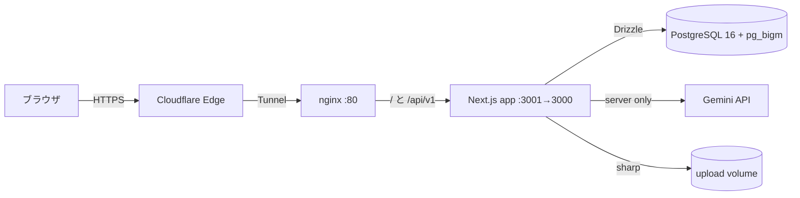

# 刷新方針: Next.js 単一アプリ + TypeScript バックエンドへの移行

> 決定日: 2026-11-27 / 状態: 方針決定（実装前）
> 正本: 本書。DB 構造は `docs/dev/db/schema.md`、現行の運用は `docs/DEPLOYMENT.md`。

## 1. なぜ作り直すか

現行は Next.js（フロント）＋ FastAPI（バックエンド）＋ PostgreSQL の3層で、次の問題が積み上がっている。

| 問題 | 具体例 |
| --- | --- |
| 契約の二重管理 | `/auth/register` がフロントの期待（トークン）とバックエンドの実装（ユーザー情報）で食い違い、ログインが成立しない期間があった |
| 型の不接続 | Pydantic と TypeScript の型が別管理。`image_path` のように削除済みカラムを参照するコードが残り、`GET /search` が壊れている疑い |
| 実行環境の二重化 | Python 3.13 + uv と Node + pnpm の両方を保守。CI は2ジョブ構成で、片方（ruff）が常時赤 |
| 検索が設計どおり動いていない | `pg_bigm` の GIN 索引が `LIKE` で使われていない（`docs/dev/db/schema.md` の計測参照） |
| ドキュメントの陳腐化 | デプロイ手順が実態（Cloudflare 前段）と乖離し、Tailscale 前提の記述が残っていた |

「機能はほぼ揃っているが、層の分断で壊れ続ける」状態なので、**機能を保ったまま実装を1つに畳む**。

## 2. 決定事項

1. **Next.js 単一アプリに統一する。** フロントもバックエンドも TypeScript。
2. **バックエンドは Next.js のサーバー側（Route Handlers / Server Actions）で書く。** 別プロセスの API サーバーを立てない。
3. **DB は PostgreSQL 16 + `pg_bigm` を継続する。** 既存データ（名刺・連絡先・画像・関係）は保持する。
4. **公開 URL とインフラは据え置く。** Cloudflare Tunnel → nginx → コンテナ。Tailscale 限定の前提は廃止。
5. **現行 REST API（`/api/v1/*`）と互換の経路を先に作り、後から内部化する。** 一括置換を避けて段階的に切り替える。

## 3. 非目標

- モバイルネイティブアプリ化（Web のまま）
- マルチテナント化・共有機能（現行同様、`user_id` による単一ユーザー空間）
- UI デザインの全面刷新（既存 SCSS + shadcn/ui を流用）
- OCR エンジンの変更（Gemini を継続。ただし呼び出しはサーバー側に閉じる）

## 4. 目標スタック

| レイヤ | 採用 | 備考 |
| --- | --- | --- |
| フレームワーク | Next.js 16（App Router） | 現行と同じ。`output: "standalone"` |
| 言語 | TypeScript（strict） | フロント・サーバー共通 |
| API | Route Handlers（`app/api/v1/**/route.ts`）→ 将来 Server Actions / Server Components | 画面から直接 DB を読む形へ寄せる |
| ORM / クエリ | **Drizzle ORM + postgres.js**（推奨） | SQL 寄りで `pg_bigm` の raw SQL 索引・再帰 CTE を書きやすい。Prisma は代替案 |
| マイグレーション | drizzle-kit（生成）＋ 手書き SQL（拡張・GIN 索引・再帰） | Alembic の履歴を初期マイグレーションとして1本に統合 |
| 認証 | **Auth.js（NextAuth v5）の Credentials プロバイダ + JWT セッション Cookie** | 既存 `users` テーブルをそのまま認証する。`accounts` テーブルは OAuth 用で、メール/パスワードでは不要 |
| パスワード | 既存の bcrypt（`$2b$12$`）を Node 側（`bcryptjs` / `@node-rs/bcrypt`）で検証。将来 argon2 へ遅延再ハッシュ | 現行 passlib bcrypt と互換 |
| 画像処理 | `sharp` | webp 変換・サムネイル生成（現行 `_save_as_webp` 相当） |
| OCR | Gemini API（サーバー側からのみ） | API キーはサーバー env。クライアントへ出さない |
| スタイル | SCSS Modules + shadcn/ui | Tailwind は使わない（既存方針） |
| テスト | Vitest（unit）/ Playwright（E2E）/ `tsc --noEmit` / `next build` | すべて CI で必須にする |
| 実行環境 | Docker Compose（app + db）＋ nginx ＋ Cloudflare Tunnel | Python コンテナは廃止 |

## 5. 構成



ディレクトリ案（現行フロントを土台にする）:

```
app/
  (auth)/login, register
  (main)/namecards, relationships, tags, import-export, help
  api/v1/
    auth/{register,login,logout,me}/route.ts
    namecards/route.ts, [id]/route.ts, [id]/images/route.ts ...
    images/{upload,process,process-additional,[namecardId]}/route.ts
    relationships/route.ts, [id]/route.ts, tree/route.ts
    tags/route.ts, [id]/route.ts
    search/route.ts
    export/json/route.ts, import/json/route.ts
lib/
  db/{schema.ts, client.ts, queries/*.ts}   # Drizzle スキーマとクエリ
  auth/{session.ts, password.ts, guard.ts}
  ocr/{gemini.ts, geometry.ts}
  storage/{images.ts}
migrations/                                 # drizzle-kit + 手書き SQL
```

## 6. API 移行表（現行 → 新）

現行のまますべてのパスと JSON 形状を維持する。フロントの `lib/api/*` は書き換えずに済ませ、置換後に順次サーバー側へ寄せる。

| 現行エンドポイント | 新実装 | 備考 |
| --- | --- | --- |
| `POST /api/v1/auth/register` | Route Handler | 応答は `UserResponse`（`id`/`email`/`created_at`） |
| `POST /api/v1/auth/login` | Route Handler | トークンを Set-Cookie に変更（本文は互換のため `access_token` も返す移行期間を設ける） |
| `GET /api/v1/auth/me` | Route Handler | Cookie から解決 |
| `GET/POST /api/v1/namecards`、`GET/PATCH/DELETE /namecards/{id}` | Route Handlers | 一覧は検索条件を受け取る |
| `POST/DELETE/PUT /namecards/{id}/images...` | Route Handlers | `sharp` で webp + サムネイル |
| `POST /api/v1/images/upload`、`/process`、`/process-additional` | Route Handlers | Gemini 呼び出しはサーバーのみ |
| `GET /api/v1/images/{namecard_id}`、`/{id}/thumbnail` | Route Handlers | 画像配信 |
| `GET/POST /api/v1/relationships`、`/tree`、`{id}` の GET/PATCH/DELETE | Route Handlers | 再帰 CTE は raw SQL |
| `GET/POST /api/v1/tags`、`{id}` の GET/PATCH/DELETE | Route Handlers | |
| `GET /api/v1/search` | Route Handler | `image_path` 参照の不整合を解消して実装 |
| `GET /api/v1/export/json`、`POST /api/v1/import/json` | Route Handlers | CSV / vCard は将来拡張 |

## 7. データとマイグレーション

- **既存 DB をそのまま使う。** テーブル名・カラム名・型・ID を維持し、データ移行は行わない（最も安全）。`alembic_version` は新方式の管理テーブルへ置き換える。
- 初期マイグレーションは `docs/dev/db/schema.md` の実測 DDL を正とし、以下を同時に改善する。
  - 外部キー索引の追加（`user_id`、`name_card_id`、`tag_id`、`relationship_id`、`parent_id`）
  - `ON DELETE` の明示（`contact_methods` と中間テーブルは CASCADE か明示削除かを決定）
  - 一意制約（`tags(user_id, name)`、`relationships(user_id, parent_id, name)`）
  - `updated_at` をトリガーにするか、アプリ更新を維持するか決定
- 移行リハーサルはダミーデータの DB で行う。実データのコピーを開発環境へ持ち込まない。
- 切り替え前に `pg_dump` を取り、件数（users / name_cards / contact_methods / name_card_images / relationships / tags）を新旧で突合する。

## 8. 認証

**Auth.js（NextAuth v5）の Credentials プロバイダで、既存 `users` テーブルをそのまま認証する。** アカウントの「連携」作業は発生しない。

- `authorize()` で `users` を `email` で引き、`password_hash` を bcrypt で検証して `{ id, email }` を返す。Auth.js はユーザー保存先に依存しないため、旧アカウント＝そのまま新アカウントになる。
- Auth.js の `accounts` / `sessions` テーブルは OAuth 用。Credentials のみなら不要（後述の制約により DB セッションも使わない）。
- **制約**: Credentials プロバイダは `session.strategy = "jwt"` が必須。Cookie は httpOnly / Secure / `SameSite=Lax` で、中身は `AUTH_SECRET` で署名・暗号化された JWT。JS からは読めない。
- ログアウトは Cookie 破棄。旧 localStorage の JWT は無効化し、全ユーザーに再ログインを求める。
- **将来 OAuth（Google 等）を足す場合のひも付け**: 同 `email` で `accounts` 行を作れる（`allowDangerousEmailAccountLinking` はパスワードを持つ既存ユーザーには危険なので使わず、初回のみログイン済み状態からリンクさせる）。ユーザーが3〜4人なので、必要なら個別に手動リンクでも足りる。
- 既存データの実測: users は4行、`password_hash` はすべて bcrypt `$2b$12$`（Node の `bcryptjs` でそのまま検証可能）。1行は動作確認用の可能性がある。
- 画面側は Server Component で `auth()` を呼び、未認証はサーバー側で `/login` へリダイレクト（現行 `AuthGuard` の初回空白を無くす）。

## 9. 画像・OCR

- アップロードは Route Handler（`multipart/form-data`）で受ける。`sharp` で webp 化とサムネイル生成を行い、`name_card_images.image_path` へ保存。保存先は当面ローカルボリューム（`upload_data`）。
- Gemini 呼び出しはサーバー側に閉じる。API キーはクライアントへ渡さない（現行同様）。
- 名刺画像は個人情報。開発・テストはダミー画像のみ。ログに画像パス以上の情報を出さない。
- 四隅座標の補正ロジック（`CameraOCRFlow` / `CornerSelector`）は純関数として切り出し、Vitest で単体テストを付ける。

## 10. 検索

現行の仕様（氏名・かな・メモ・出会い・所属階層・連絡先の横断、タグ/所属/日付フィルタ、ページング）を維持する。実装は次のいずれかを Phase 3 で確定する。

1. `pg_bigm` を活かす: `pg_bigm.gin_key_like` を有効化できる構成にする（現サーバーでは未登録のため要対応）
2. `pg_bigm` の `=%` 演算子を使う（`LIKE` ではなく bigm 専用演算子で索引を使う）
3. `pg_trgm` + `gin_trgm_ops` へ変更（日本語2文字検索の精度は低下するため非推奨）

所属階層の検索は再帰 CTE を raw SQL で維持し、`EXPLAIN` で索引利用を確認してから完了とする。

## 11. テストと CI

| 種別 | 内容 | 必須 |
| --- | --- | --- |
| 型 | `tsc --noEmit`（テスト含む。`vitest/globals` を tsconfig に追加） | ○ |
| Lint/Format | Biome（CRLF 問題を避けるため `.gitattributes` で `eol=lf`） | ○ |
| Unit | Vitest（スキーマ・正規化・座標計算・各クエリ） | ○ |
| Build | `next build` | ○ |
| E2E | Playwright（登録→ログイン→名刺作成→検索→画像→エクスポート） | ○ |
| DB | ダミー DB に対するマイグレーション適用とロールバック | ○ |

CI は1ジョブ（Node 22 + pnpm 11）に統合し、赤のまま `main` へ入れない。pnpm の版は CI とローカルで一致させる。

## 12. デプロイ

- コンテナは `app` と `db` の2つ。`app` は standalone 出力、ホスト `127.0.0.1:3001` → コンテナ `3000`。
- nginx（`/etc/nginx/sites-available/name_nozyjp`）はパスをそのまま転送する構成を維持し、`/api/` の転送先を `app` に付け替える。
- Cloudflare Tunnel と DNS は変更しない。TLS 終端は Cloudflare。
- 反映は手動（`git checkout <commit>` → `docker compose build && up -d`）。本番反映は人の承認を得てから行う。
- ロールバックは旧イメージと旧コミットの再チェックアウトで行える状態を保つ（旧 FastAPI イメージを切替後1か月は残す）。

## 13. 段階的移行

| Phase | 内容 | 完了条件 |
| --- | --- | --- |
| 0 | 準備: 作業ブランチ、CI 緑化（ruff/biome の既存違反解消）、`.gitattributes`、ドキュメント整備 | CI が緑。未コミット差分の扱い決定 |
| 1 | スキーマ移植: Drizzle スキーマ＋初期マイグレーション、FK 索引・一意制約の追加 | ダミー DB で適用/ロールバック成功。本番 DDL と一致 |
| 2 | 認証: 登録・ログイン・`me`・ログアウトを Cookie セッションで実装 | Playwright で認証フロー通過。旧 API と並行稼働 |
| 3 | 名刺 CRUD と検索: Route Handlers + サーバー側クエリ | 一覧・詳細・登録・編集・削除・検索の E2E 通過。`EXPLAIN` で索引利用確認 |
| 4 | 画像と OCR: アップロード、webp 化、サムネイル、Gemini 連携 | ダミー画像で撮影→四隅→OCR→保存が通る |
| 5 | タグ・所属・エクスポート/インポート | 既存 JSON の入出力互換 |
| 6 | 切替: nginx を新アプリへ、FastAPI 停止 | 本番で主要導線を確認。再ログイン実施 |
| 7 | 後片付け: Python コード・CI ジョブ・`docker/` の Python 分を削除 | リポジトリに Python が残らない |

各 Phase は個別にデプロイ可能な単位とし、Phase 6 まで旧実装を動かしたまま進める。

## 14. リスク

| リスク | 影響 | 対策 |
| --- | --- | --- |
| 認証切替で全ユーザーのセッションが切れる | 一時的に再ログインが必要（3〜4人なので実害は小さい） | 事前告知。Cookie 発行後に旧 JWT を一定期間受理する互換期間を設ける |
| 画像パスの整合 | 既存の `image_path` と新ストレージ実装の不一致で画像が出ない | 既存パスを読み取り専用で解決する互換レイヤを用意し、Phase 4 で検証 |
| `pg_bigm` の索引が効かないまま | 件数増加で検索が遅くなる | Phase 3 で `EXPLAIN` を完了条件にする |
| 一括置換による長期停止 | 名刺データが参照できない時間が発生 | Phase 6 は切替のみに限定し、直前まで旧実装で稼働 |
| 実データの漏えい | 個人情報の事故 | 開発・テストはダミーのみ。ダンプを共有領域・外部サービスへ置かない |
| OCR 画像の外部送信 | Gemini へ名刺画像が渡る | 現行踏襲であることを明記。必要ならローカル OCR を将来検討 |

## 15. 未決事項と決定事項

### 決定（2026-11-27 ユーザー回答）

1. **既存データ**: 本番 DB を共用して保持する（テーブル定義・ID を維持、データ移行なし）。
2. **リポジトリ**: 現行リポジトリ内で置き換える（履歴・Issue・Cloudflare 設定を維持、作業ブランチで進める）。
3. **認証**: Auth.js（Credentials プロバイダ、JWT セッション Cookie）。既存 `users` をそのまま認証し、連携作業は行わない。

### 未決

4. **ORM**: Drizzle（推奨）か Prisma か。Auth.js の Drizzle アダプタを使わないならどちらでも可。
5. **`company_name` / `department` / `position`**: Relationship と二重管理のまま維持するか、どちらかへ寄せるか。

## 16. 受け入れ条件

- 主要導線（登録・ログイン・名刺の作成/一覧/検索/詳細/編集/削除・画像/OCR・タグ・所属・エクスポート）が本番で動作する。
- 既存データの件数と内容が移行前後で一致する。
- CI（型・lint・unit・build・E2E）が緑。
- リポジトリから Python 実装と Python 用 CI が消え、ドキュメントが実態と一致している。
- 名刺の実データがログ・チャット・共有領域・外部サービスへ出ていない。
